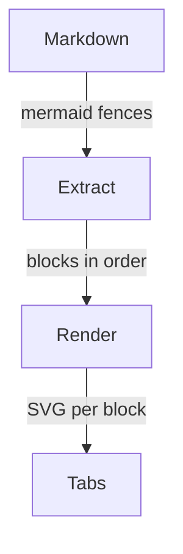
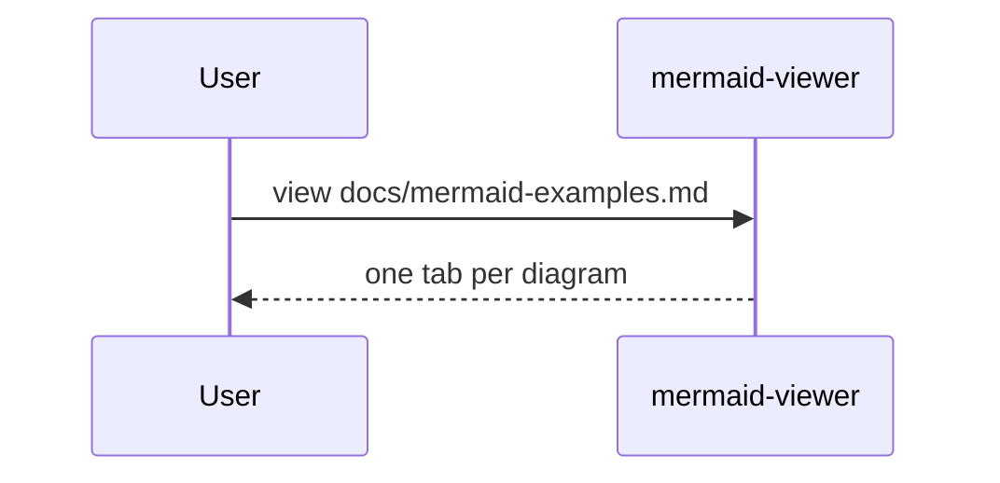
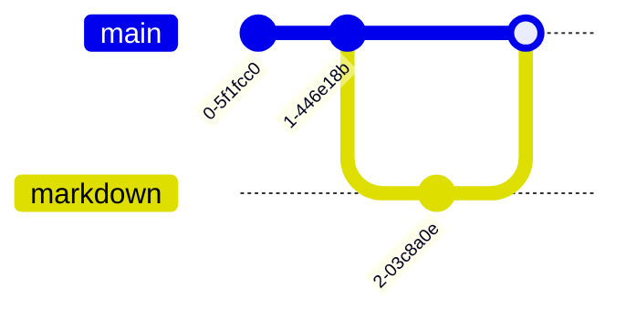

# Mermaid examples

This file manually exercises the Markdown input path of `mermaid-viewer view`: every fenced block tagged `mermaid` is extracted and shown as one tab, in document order.

```sh
mermaid-viewer view docs/mermaid-examples.md
```

## Flowchart — the Markdown view path

The four stages of the path this file exercises, from raw Markdown to labeled tabs in the viewer window.



## Sequence — invoking the viewer

The exchange when this file is viewed. The user requests the view and the viewer replies with one tab per diagram.



## GitGraph — the feature-branch history

A feature-branch history in the style of this repository's planning work: one branch, one branch commit, and a merge back to main.


